# Managed SQL and Key Vault on Azure

## 🎬 Watch the walkthrough

The walkthrough video is added here after it is recorded, with a GIF thumbnail that opens the recording, the same way as the other projects. Face on camera for the introduction, the architecture, and the close.

**Author:** Zeon Stewart, [LinkedIn](LINKEDIN_LINK_HERE)

## At a glance

- **What it is:** a web server on Microsoft Azure that connects to a managed SQL database without the database password ever appearing in code, on disk, or in a config file.
- **What's automated:** one Python command builds the vault, the database, and the server. A second command checks the result. A third deletes it and frees the vault name.
- **Why it's secure:** the password lives only in Azure Key Vault. The server proves who it is with a managed identity, so it has no password of its own to leak. Its role can read secrets and cannot change them.
- **Why it's managed:** Azure SQL Database is Platform as a Service (PaaS). Microsoft patches, backs up, and runs the database engine. There is no database virtual machine (VM) to maintain.
- **Result:** checks 1 through 6 passed on `python -m src.verify`. Check 7 waits for teardown. Evidence is under [Success criteria](#success-criteria).

Part of [Cloud Projects](https://github.com/zsociety47/cloud-projects). Technical details and lessons learned are in [Technical findings](#technical-findings) at the bottom.

---

## Project Steps

These steps build the same design by hand in the [Azure portal](https://portal.azure.com), in the same order `python -m src.deploy` uses. The vault and its secret come first, because the SQL server's password is the secret. The web VM's role on the vault comes before the VM tries to read it.

Use East US for every resource except the SQL server and database, which go in Central US (step 5 explains why). On each resource, add the tags `project = azure-sql-keyvault-poc`, `environment = poc`, `managed-by = portal`, and `owner = <your name>`. The Python deploy uses `managed-by = python-sdk` and `owner = zeon` so a hand-built group and a script-built group are easy to tell apart.

The names below are this build's. Key Vault and SQL server names are public hostnames, so they must be unique across Azure. If you change them, change them in `src/lib/config.py` and at the top of `src/guest/web-setup.sh` too.

Portal labels move from time to time. If a button has moved, search for the setting name in the portal's top search bar. Each step below has a screenshot of what the portal should show when that step is done. The automated teardown picture stays commented out until that file exists.

### Before the portal: the Secure Shell key, your address, and a password

*Automated by `src/lib/sshkey.py`, `src/lib/public_ip.py`, and `src/deploy.py` on the first `python -m src.deploy`.*

Secure Shell (SSH) is port 22. The VM accepts an SSH public key and refuses password login. Create the key on your own machine. The private key stays in `keys/`, which is gitignored. Only the public half is pasted into the portal.

```bash
mkdir -p keys
ssh-keygen -t ed25519 -f keys/id_ed25519 -N ""
```

Find your current public Internet Protocol (IP) address. Open `https://api.ipify.org` in a browser. You will use `<that address>/32` as the only source allowed to SSH to the VM. Do not commit that address.

Create the SQL admin password in your password manager: at least 16 characters, with uppercase, lowercase, a number, and a symbol. You paste it twice, into Key Vault in step 4 and into the SQL server in step 5. After that, nothing in this project needs you to type it again. Do not save it in a file in this folder.

### Step 1: Create a resource group

*Automated by `python -m src.deploy`.*

1. Search for **Resource groups** and select **+ Create**.
2. **Resource group:** `rg-paas-poc-zeon01`. **Region:** East US.
3. **Tags** tab: the four tags above.
4. Select **Review + create**, then **Create**.

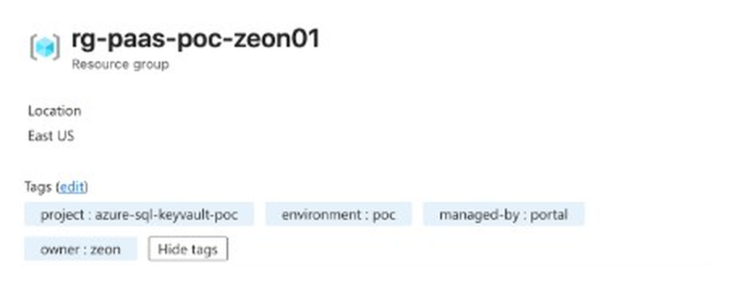

### Step 2: Create the Key Vault

*Automated by `python -m src.deploy`.*

1. Search for **Key vaults** and select **+ Create**.
2. **Basics:** resource group `rg-paas-poc-zeon01`. **Name:** `kv-paas-zeon01`. **Region:** East US. **Pricing tier:** Standard. Premium adds a hardware security module (HSM), which this project does not need.
3. **Recovery options:** soft-delete is on and cannot be turned off. **Days to retain deleted vaults:** 90. **Purge protection:** Disable. With purge protection on, the vault name stays reserved for the full 90 days after cleanup.
4. **Access configuration:** **Permission model:** Azure role-based access control (RBAC). Leave the three **Resource access** boxes unchecked. They let VM deployment, template deployment, and disk encryption read the vault, and this project uses none of them.
5. **Networking:** **Enable public access** checked, **All networks**. No private endpoint. The portal warns that every public network can reach the vault. RBAC still decides who can read a secret, and step 10 is the only grant the VM gets.
6. Select **Review + create**, then **Create**.

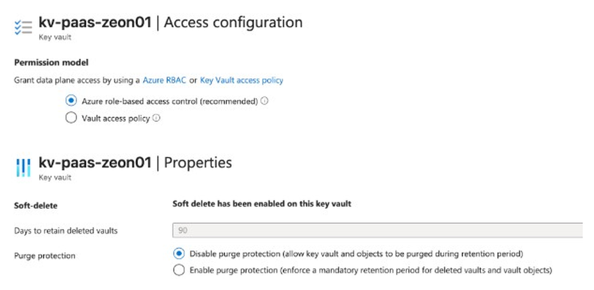

### Step 3: Give yourself Key Vault Administrator

*Automated by `python -m src.deploy`.*

With RBAC, nobody can read or write secrets until a role is assigned, including the person who created the vault. **Secrets** shows "The operation is not allowed by RBAC" until this step is done.

1. Open `kv-paas-zeon01` and select **Access control (IAM)**. IAM is identity and access management.
2. **+ Add** > **Add role assignment**. Search for **Key Vault Administrator**, select it, then **Next**.
3. **Assign access to:** User, group, or service principal. **+ Select members**, pick your own account, then **Select**.
4. **Review + assign**, twice.
5. Wait one to two minutes for the role to take effect.

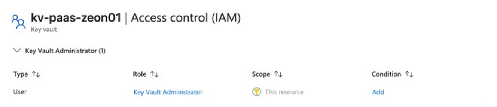

### Step 4: Store the password as a secret

*Automated by `python -m src.deploy`.*

1. In the vault, open **Objects** > **Secrets** and select **+ Generate/Import**.
2. **Upload options:** Manual. **Name:** `SqlAdminPassword`. **Secret value:** the password you created. Leave content type, activation date, and expiration date empty. **Enabled:** Yes.
3. Select **Create**.

The secret list shows `SqlAdminPassword` as Enabled. Opening a version shows its details. Key Vault does not show the value unless you choose **Show Secret Value**, and you do not need to.

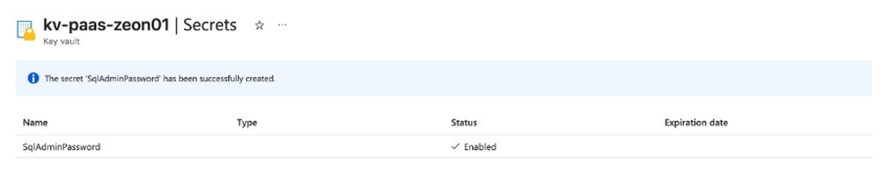

### Step 5: Create the SQL server and sqldb-app

*Automated by `python -m src.deploy`.*

In Azure, a SQL server is a logical container: the admin login, the firewall, and the region. The database lives inside it. The portal creates both in one form.

1. Search for **SQL databases** and select it. Do not select **SQL servers**.
2. Open the arrow on **+ Create** and choose **SQL database**, not the free offer.
3. If a green banner says the free offer is applied, select **Remove offer** or **Advanced configuration**, and wait until the banner is gone. While it is applied, the Database Transaction Unit (DTU) tiers are hidden and the form only offers General Purpose serverless.
4. **Basics:**
   - **Resource group:** `rg-paas-poc-zeon01`.
   - **Database name:** clear any generated name and enter `sqldb-app`. A database cannot be renamed after it is created.
   - **Server:** **Create new**. **Server name:** `sql-paas-zeon01`. **Location:** Central US, not East US. This subscription cannot create a SQL server in East US, and Central US is the nearest region that accepts one. See [Technical findings](#technical-findings). **Authentication method:** Use SQL authentication. **Server admin login:** `sqladmin`. **Password:** the same password you stored in step 4. Select **OK**.
   - **Want to use SQL elastic pool?** No.
   - **Workload environment:** Development. Production points the form at a much more expensive tier.
   - **Compute + storage:** **Configure database**. Choose **DTU-based**, then **Basic** (5 DTUs, 2 GB). Select **Apply**. The cost summary should be about $5 a month.
   - **Backup storage redundancy:** Locally-redundant backup storage. That is locally redundant storage (LRS), copied within one datacenter.
5. **Networking:**
   - **Connectivity method:** Public endpoint.
   - **Allow Azure services and resources to access this server:** No. Yes would open the server to every address inside Azure, not only this project's VM.
   - **Add current client IP address:** Yes. That rule is your current address only.
   - **Minimum Transport Layer Security (TLS) version:** 1.2.
6. **Security:** **Microsoft Defender for SQL:** Not now. It costs about $15 per server per month.
7. **Additional settings:** **Use existing data:** None. Leave the default collation, `SQL_Latin1_General_CP1_CI_AS`.
8. **Tags:** the four tags.
9. **Review + create.** Confirm the tier is Basic and the server is `sql-paas-zeon01`. Select **Create**. It takes a few minutes.

The portal names your firewall rule after the date and time, something like `ClientIp-2026-10-12_22-27-9`. The Python deploy names the same rule `AllowOperator`.

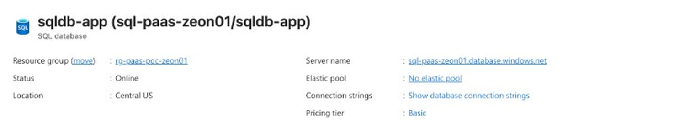

### Step 6: Create the web public IP and allow it through the SQL firewall

*Automated by `python -m src.deploy`.*

The VM reaches SQL from this address, so the firewall rule needs it before the VM connects.

1. Search for **Public IP addresses** and select **+ Create**.
2. **Name:** `pip-web-01`. **Resource group:** `rg-paas-poc-zeon01`. **Region:** East US. **SKU:** Standard. SKU is the stock-keeping unit, the pricing tier. **Assignment:** Static. **IP version:** IPv4.
3. Create it, then copy its address from **Overview**.
4. Open `sql-paas-zeon01`, then **Security** > **Networking**. Under **Firewall rules**, select **+ Add a firewall rule**. **Rule name:** `AllowWebVm`. Start and end IP: the `pip-web-01` address. Leave **Allow Azure services and resources to access this server** unchecked. Select **Save**. Open the SQL *server*, not the database. The database page has no firewall settings of its own.

The addresses in this picture are covered on purpose.

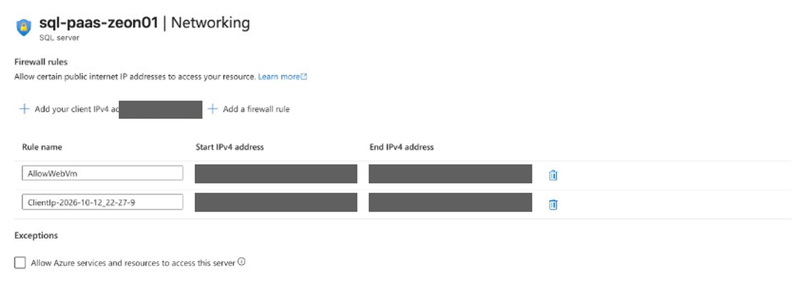

### Step 7: Firewall the web subnet

*Automated by `python -m src.deploy`.*

A network security group (NSG) is the subnet firewall. Create it now and attach it to the subnet in step 8.

1. Search for **Network security groups** and select **+ Create**.
2. **Name:** `nsg-web`. **Resource group:** `rg-paas-poc-zeon01`. **Region:** East US.
3. After it is created, open **Inbound security rules** and add one rule:

| Name | Priority | Source | Source port | Destination port | Protocol | Action |
|---|---|---|---|---|---|---|
| Allow-Ssh-Operator | 100 | Your current public IP address, as a `/32` | `*` | 22 | TCP | Allow |

TCP is the Transmission Control Protocol. No other inbound port is open. This project has no web page. The VM only makes outbound calls, to Key Vault on port 443 and to SQL on port 1433.

The source address in this picture is covered on purpose.

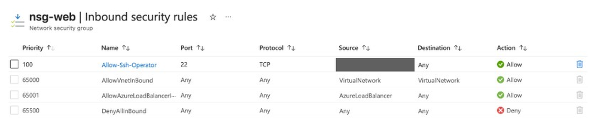

### Step 8: Create the virtual network

*Automated by `python -m src.deploy`.*

1. Search for **Virtual networks** and select **+ Create**.
2. **Resource group:** `rg-paas-poc-zeon01`. **Name:** `vnet-paas-poc`. **Region:** East US.
3. **IP addresses:** change the address space to `10.1.0.0/16` first. The portal suggests `10.0.0.0/16`, and a `10.1.1.0/24` subnet is rejected with "The subnet address range '10.1.1.0/24' is not contained in the address space 10.0.0.0/16" until the space is changed. Delete the default subnet and add `snet-web`, `10.1.1.0/24`, with NSG `nsg-web`. Turn **default outbound access** off. The portal may call that a private subnet.
4. Select **Review + create**, then **Create**.
5. Open **Settings** > **Subnets** and check that the **Security group** column shows `nsg-web`. If you re-added the subnet while fixing the address space, the NSG choice can be lost. Select `snet-web`, set the NSG, and save.

The address range does not overlap the two-tier project's `10.0.0.0/16`, so both can exist at once. Outbound traffic leaves through `pip-web-01`, which is why the SQL firewall in step 6 allows that address.

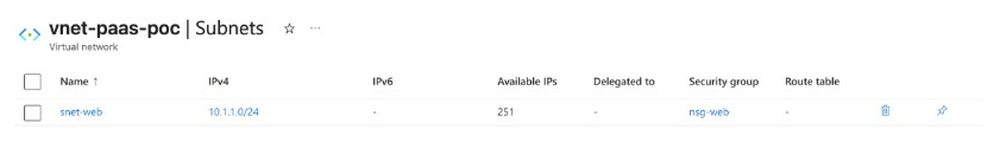

### Step 9: Create the web VM with a managed identity

*Automated by `python -m src.deploy`.*

A system-assigned managed identity is an identity in Microsoft Entra ID that belongs to this VM. Azure manages its credential. Deleting the VM deletes the identity.

1. Search for **Virtual machines** and select **+ Create** > **Azure virtual machine**.
2. **Basics:** resource group `rg-paas-poc-zeon01`. **Name:** `vm-web-01`. **Region:** East US. **Image:** Ubuntu Server 24.04 Long Term Support (LTS). **Size:** Standard_F1als_v7 (1 vCPU, 2 GB). **Authentication:** SSH public key, username `azureuser`, paste `keys/id_ed25519.pub`. **Public inbound ports:** None. The subnet NSG is the firewall.
3. **Disks:** 30 GB, Standard SSD LRS. SSD is a solid-state drive. Delete the disk with the VM.
4. **Networking:** open the **Virtual network** dropdown and choose `vnet-paas-poc`. The portal defaults to a new network, such as "(new) vnet-eastus-1", which has no NSG. A network interface cannot be moved to another network later, so a VM created on the wrong one has to be deleted and recreated. **Subnet:** `snet-web`. **Public IP:** the existing `pip-web-01`. **NIC network security group:** None. NIC is the network interface. Leave **Delete public IP and NIC when VM is deleted** unchecked, so `pip-web-01` and its SQL firewall rule survive if you ever delete the VM. On **Review + create**, check that the virtual network line says `vnet-paas-poc` before you select **Create**.
5. **Management:** check **Enable system assigned managed identity**.
6. **Tags:** the four tags. Select **Review + create**, then **Create**.
7. Open the VM, then **Security** > **Identity**. **Status** is On and an **Object (principal) ID** is shown. That ID is what step 10 grants access to.
8. The portal names the network interface and gives it a dynamic address. `python -m src.deploy` creates `nic-web-01` at `10.1.1.4`. To match, open **Network settings**, the network interface, **IP configurations**, `ipconfig1`, set Static `10.1.1.4`, and save.

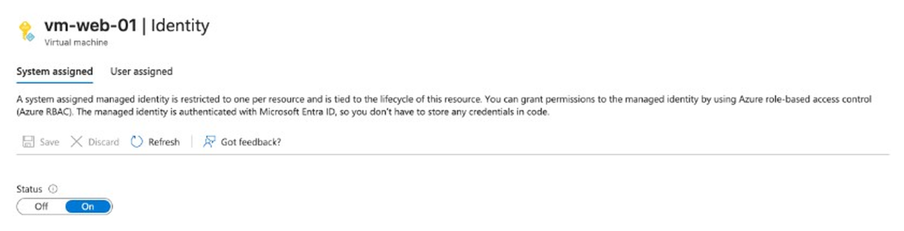

### Step 10: Let the VM read secrets

*Automated by `python -m src.deploy`.*

1. Open `kv-paas-zeon01` > **Access control (IAM)** > **+ Add** > **Add role assignment**.
2. **Role:** Key Vault Secrets User. It can read secret values. It cannot create, change, or delete them.
3. **Members:** **Assign access to** Managed identity. **+ Select members**, **Managed identity:** Virtual machine, select `vm-web-01`, then **Select**.
4. The **Conditions** tab is skipped for a managed identity. **Review + assign**, twice.
5. **Role assignments** now lists `vm-web-01`, type Managed identity, with Key Vault Secrets User at scope "This resource".

If `vm-web-01` is not in the member list, check step 9 for the object ID and wait a minute.

The identity's ID under the VM name is covered in this picture.

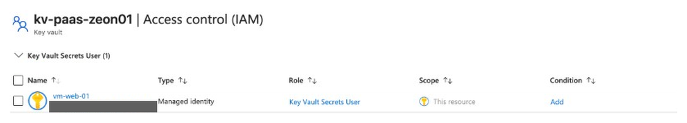

### Step 11: Read the secret and query the database from the VM

*Automated by `python -m src.deploy`, which sends `src/guest/web-setup.sh` with Azure VM Run Command.*

1. Open `vm-web-01` > **Operations** > **Run command** > **RunShellScript**.
2. Paste the contents of `src/guest/web-setup.sh` and select **Run**. The file has no password in it.
3. The script installs `sqlcmd`. It asks the Azure Instance Metadata Service (IMDS) at `169.254.169.254` for a Key Vault token, then reads `SqlAdminPassword` with that token. It connects to `sql-paas-zeon01.database.windows.net` as `sqladmin` and runs `SELECT 1`.
4. Installing `sqlcmd` takes a few minutes, and the output appears only when the script finishes. The standard output ends with `(1 rows affected)` and `sql-connected`. It does not contain the password. A `[stderr]` section below it lists Ubuntu's package-restart messages, such as "Running kernel seems to be up-to-date". Those are not errors.

A 403 on the secret usually means the role from step 10 has not taken effect yet. The script retries for about three minutes.

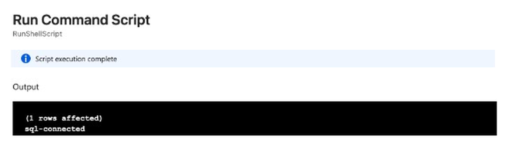

Next, prove the VM's role is read-only. Run this in the same **RunShellScript** box. It asks for a token the same way, then tries to write a new secret named `WriteTest`. It prints only the HTTP status code, never the token:

```bash
token=$(curl -fsS -H Metadata:true \
  "http://169.254.169.254/metadata/identity/oauth2/token?api-version=2018-02-01&resource=https%3A%2F%2Fvault.azure.net" \
  | python3 -c 'import json,sys; print(json.load(sys.stdin)["access_token"])')
curl -sS -o /dev/null -w '%{http_code}\n' -X PUT \
  -H "Authorization: Bearer ${token}" -H "Content-Type: application/json" \
  -d '{"value":"blocked-on-purpose"}' \
  "https://kv-paas-zeon01.vault.azure.net/secrets/WriteTest?api-version=7.4"
unset token
```

The output is `403`. Key Vault Secrets User can read secret values but cannot create, change, or delete them. A `200` means the VM has a broader role than step 10 gives it, and **Secrets** now lists `WriteTest`.

The output below is from the write test script above. Its only standard output is the HTTP status code.

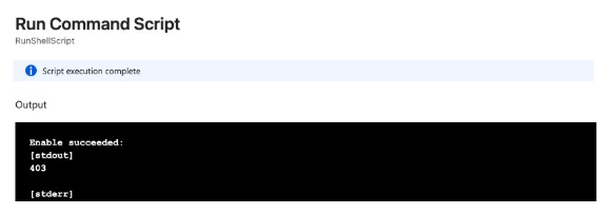

### Step 12: Watch the database in Azure Monitor

*Checked by `python -m src.verify`.*

1. Open `sqldb-app`. The header reads `sqldb-app` with the subtitle **SQL database**. If the subtitle says **SQL server**, open **SQL databases** under that server and select `sqldb-app`.
2. **Overview:** the pricing tier is Basic and the status is Online.
3. **Monitoring** > **Metrics**. **Metric:** Successful Connections. **Aggregation:** Sum.
4. The chart shows a point for each five-minute window with a login. The Run command in step 11 is one successful connection. A new point can take a few minutes to appear.

This database does not publish DTU percentage. Its metric list has CPU percentage, Data IO percentage, the connection counts, Blocked by Firewall, and Availability, and the portal finds nothing for "DTU". Successful Connections is the better signal here anyway, because it records the VM's login itself.

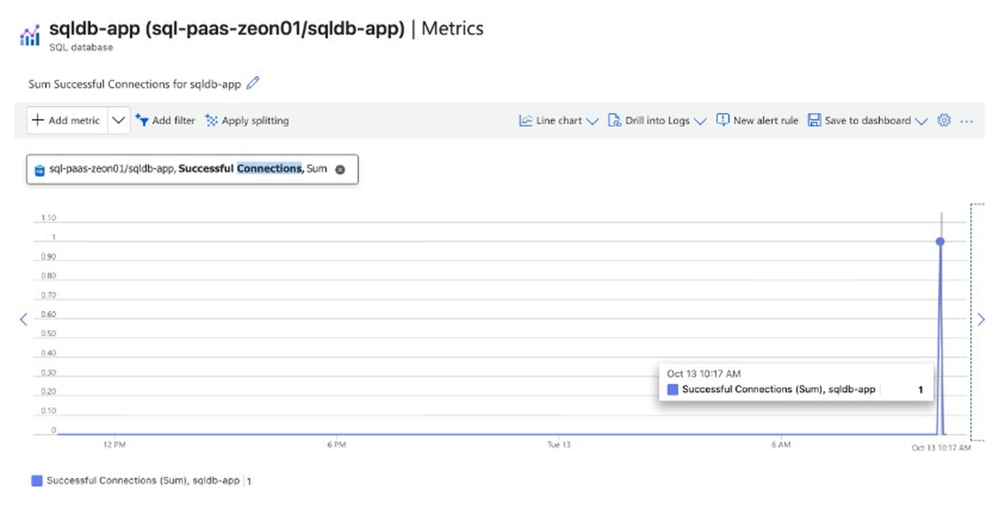

### Step 13: Clean up when you're done

*Automated by `python -m src.teardown`, which asks you to type the resource group name before it deletes anything.*

1. Open `rg-paas-poc-zeon01` and select **Delete resource group**. Type the name to confirm. That removes the VM, its disk and network interface, the public IP, the NSG, the virtual network, the SQL server and database, and the Key Vault.
2. Search for **Key vaults** and select **Manage deleted vaults**. The main Key vaults list only shows live vaults, so it looks empty after the group delete even while the name is still reserved. Select `kv-paas-zeon01`, then **Purge**. Until you purge it, the name stays reserved for 90 days and the next deploy cannot use it.
3. Confirm the resource group is gone and **Manage deleted vaults** says you have no deleted vaults in this subscription.

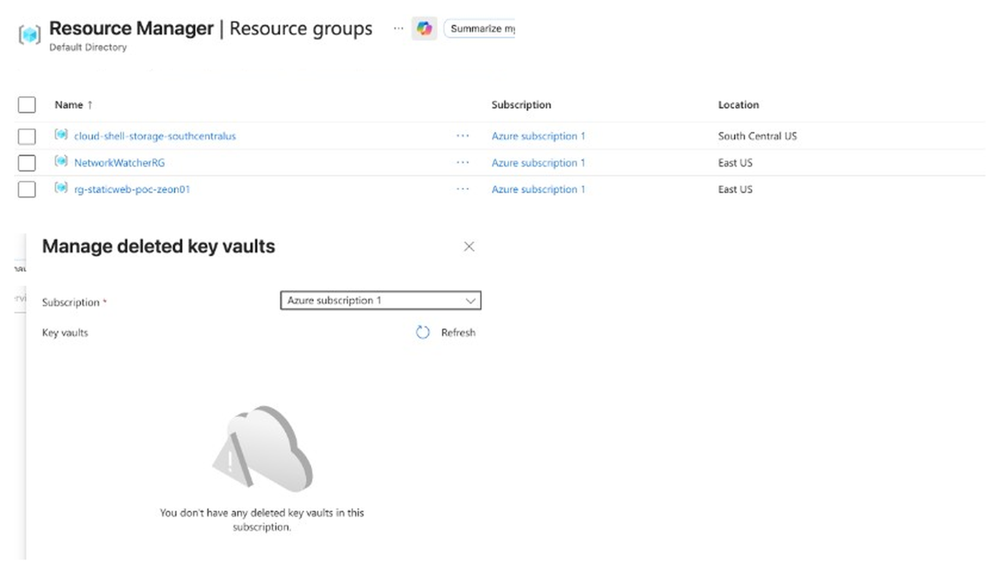

---

## Automated setup

You need Python 3.11 or newer, an Azure subscription, and a current `az login`. The scripts sign in with `DefaultAzureCredential` from the Azure software development kit (SDK). No password is stored in the repository.

From the repository root:

```bash
python3 -m venv .venv
source .venv/bin/activate
pip install -r requirements.txt
python -m src.deploy --plan
python -m src.deploy
python -m src.verify
```

`--plan` prints the resource names and exits. It does not call Azure.

`python -m src.deploy` covers the SSH key and steps 1 through 11. It generates the database password in memory, writes it to Key Vault and to the SQL server, and does not print it. Running it again sets a new password in both places, so they stay in agreement.

The `SSH:` line after this block holds the web VM's public address. It is left out of the picture on purpose.


`python -m src.verify` runs checks 1 through 6 and prints a pass/fail table. Check 6 is the write test from step 11, and it passes only when Key Vault answers 403. Check 7 stays "not run" until the group is deleted. Check 4 compares the SQL firewall to your current public address. If your address has changed since deploy, run deploy again.

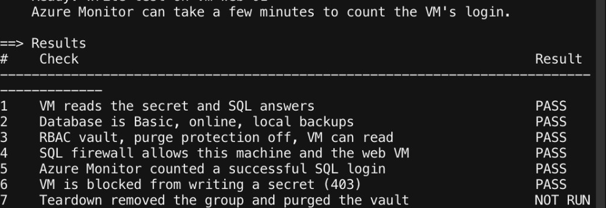

When you are finished:

```bash
python -m src.teardown
python -m src.verify --after-teardown
```

Teardown asks you to type `rg-paas-poc-zeon01`, deletes the group, then purges the soft-deleted vault.

<!-- 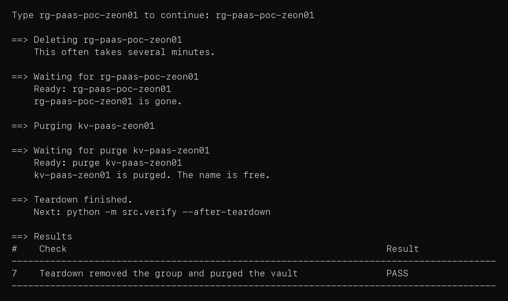 -->

Sign in with the Azure command-line interface (CLI) in a browser before the Python commands:

```bash
az login
```

If Microsoft Entra ID asks for multi-factor authentication (MFA), approve it in the browser. Do not add `--use-device-code`. That flow is often blocked when the computer is not registered with Entra ID.

### Prove it in the portal

| Check | Where to click | A pass looks like |
|---|---|---|
| 1. The VM reads the secret and SQL answers | `vm-web-01` → **Run command** → **RunShellScript** with `src/guest/web-setup.sh` | The output ends with `sql-connected` |
| 2. The database is Basic and Online | `sqldb-app` → **Overview** | Pricing tier Basic, status Online. **Compute + storage** shows locally redundant backups |
| 3. The VM can only read secrets | `kv-paas-zeon01` → **Access control (IAM)** → **Role assignments** | `vm-web-01` has Key Vault Secrets User. **Properties** shows purge protection off |
| 4. The SQL firewall allows two addresses | `sql-paas-zeon01` → **Security** → **Networking** | Two single-address rules. Azure services access is off |
| 5. The database is being monitored | `sqldb-app` → **Metrics** → Successful Connections, Sum | A point for each window with a login from the VM |
| 6. The VM is blocked from writing a secret | `vm-web-01` → **Run command** → **RunShellScript** with the write test from step 11 | The output is `403`, and **Secrets** does not list `WriteTest` |
| 7. Teardown removed everything | **Resource groups**, then **Key vaults** → **Manage deleted vaults** | The group and the vault are both gone |

### Prove it from the command line

A passing `python -m src.verify` table is:

| # | Result |
|---|---|
| 1 | VM reads the secret and SQL answers: PASS |
| 2 | Database is Basic, online, local backups: PASS |
| 3 | RBAC vault, purge protection off, VM can read: PASS |
| 4 | SQL firewall allows this machine and the web VM: PASS |
| 5 | Azure Monitor counted a successful SQL login: PASS |
| 6 | VM is blocked from writing a secret (403): PASS |
| 7 | Teardown removed the group and purged the vault: NOT RUN |

After teardown, `python -m src.verify --after-teardown` checks only row 7.

---

## Architecture

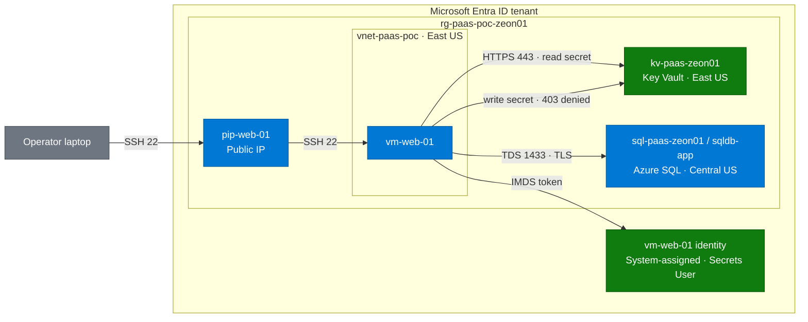

**How to read this diagram**

- **Solid arrows:** live traffic only. SSH lands on `pip-web-01`, then on the VM. The VM asks Instance Metadata Service (IMDS) for a token from its Entra ID identity, reads `SqlAdminPassword` over HTTPS, and opens SQL over Tabular Data Stream (TDS) inside Transport Layer Security (TLS). The second Key Vault arrow is a write Key Vault denies with 403.
- **Blue:** Azure resources. **Green:** identity and the vault. **Gray:** the laptop.
- Python deploy creates these resources. It is not drawn as an arrow, so those lines do not wrap around the boxes.

*The password never leaves Key Vault into this repository or onto the VM's disk. SQL is in Central US because this subscription cannot create a server in East US.*

*Diagram follows the [shared diagram standard](https://github.com/zsociety47/cloud-projects/blob/main/standards/DIAGRAM-STANDARD.md).*

---

## Hypothesis

A VM with a system-assigned managed identity can read a database password from Key Vault and query Azure SQL Database, with no password in the code, in the repository, or in the command output.

## Success criteria

| # | Criterion | How it is checked | Result |
|---|-----------|-------------------|--------|
| 1 | The VM reads `SqlAdminPassword` with its managed identity and SQL answers a query | Run Command on `vm-web-01` prints `sql-connected` | ✅ [verify](docs/images/automated-verify.png) |
| 2 | `sqldb-app` is Basic, Online, with locally redundant backups | Verify reads the database | ✅ [verify](docs/images/automated-verify.png) |
| 3 | The vault uses RBAC, purge protection is off, and the VM has Key Vault Secrets User | Verify reads the vault and its role assignments | ✅ [verify](docs/images/automated-verify.png) |
| 4 | The SQL firewall allows only the operator address and the web VM address | Verify lists the firewall rules | ✅ [verify](docs/images/automated-verify.png) |
| 5 | Azure Monitor records the VM's successful login | Verify reads Successful Connections for the last hour | ✅ [verify](docs/images/automated-verify.png) |
| 6 | The VM cannot write a secret: Key Vault returns 403 | Verify runs a write test on `vm-web-01` | ✅ [verify](docs/images/automated-verify.png) |
| 7 | Teardown deletes the group and purges the vault | `python -m src.teardown`, then `python -m src.verify --after-teardown` | Pending |

## What's in this repository

```
.
├── requirements.txt          Pinned Azure SDK packages
├── src/
│   ├── deploy.py             Creates the vault, secret, SQL server, database, network, and VM
│   ├── verify.py             Prints the pass/fail table
│   ├── teardown.py           Deletes the group after you type its name, then purges the vault
│   ├── guest/
│   │   └── web-setup.sh      Runs on the VM: reads the secret, queries SQL. No password inside
│   └── lib/                  Names, Azure clients, SSH key, public address, retries, logging
└── docs/
    └── images/               Screenshots for the steps above
```

## Security choices

- **The password exists in one place.** Deploy generates it in memory and writes it to Key Vault and to the SQL server. It is not printed, not in a file, and not in the VM's custom data. The guest script reads it into an environment variable for one `sqlcmd` call, then unsets it.
- **The VM has no credential of its own.** Its managed identity gets tokens from the instance metadata service, which is reachable only from inside the VM.
- **Least privilege on the vault.** The VM has Key Vault Secrets User: read secret values, nothing else. Verify check 6 proves it by having the VM try to write a secret and expecting 403. The operator has Key Vault Administrator, because deploy has to write the secret.
- **The SQL firewall is two addresses.** Your address at deploy time, and `pip-web-01`. "Allow Azure services" stays off, because that setting admits any address inside Azure.
- **TLS 1.2 minimum on SQL.** `sqlcmd` 18 encrypts the connection by default.
- **SSH reaches the VM only from your address.** No other inbound port is open. The private key stays in `keys/` on your machine.
- **Azure error text is not printed** when a request carried the password. The retry helper reports the HTTP status only.
- **Purge protection is off on purpose.** A proof of concept has to be able to free its vault name at teardown. A production vault holding encryption keys would turn it on.

## Cost

East US pay-as-you-go list prices, approximate, before tax:

| Piece | Rate |
|---|---|
| One Standard_F1als_v7 VM | $0.0605 per hour |
| One Standard public IP | $0.005 per hour |
| Azure SQL Database Basic (5 DTUs, 2 GB) | about $4.90 per month |
| One 30 GB operating-system disk | a few dollars a month |
| Key Vault Standard | billed per 10,000 operations. This build uses a handful |
| Microsoft Defender for SQL | off. About $15 per server per month if enabled |

A few hours for a recording is about a dollar. Left running for a month, the VM is about $44, and the database is about $5. Delete the resource group and purge the vault when you are done. Prices were checked in October 2026 and will move. Standard_B1s would be cheaper, and this subscription cannot create that size in East US.

## Going further

- Switch SQL to Microsoft Entra ID authentication and create a database user for the VM's managed identity. That removes the SQL password entirely, and Key Vault would hold only non-database secrets.
- Put Key Vault and SQL behind private endpoints and turn public access off, so traffic stays on Azure's network.
- Replace SSH with Azure Bastion, so port 22 is not open even to one address.
- Rotate `SqlAdminPassword` on a schedule with an expiration date and a rotation job.
- Describe the build in Bicep or Terraform once the design stops changing.

---

## Technical findings

*For engineers: what actually happened while building this, including the errors.*

- **`azure-monitor-query` 2.0 no longer reads metrics.** Version 2.0.0 exports only the logs client. Metrics moved to a separate package. Verify reads metrics through `azure-mgmt-monitor` 7.0.0, the Azure Resource Manager metrics API, which also matches what the portal chart shows.
- **This Basic database publishes no DTU metric.** Its metric list is CPU percentage, Data IO percentage, successful and failed connections, Blocked by Firewall, Availability, replication lag, and ledger digest uploads. Asking for `dtu_consumption_percent` returns "Failed to find metric configuration". Verify check 5 reads `connection_successful` instead, which records the VM's login itself.
- **Deleting the resource group does not free the Key Vault name.** Soft-delete keeps a deleted vault, and its name, for the retention period. Teardown purges it after the group delete, and `verify --after-teardown` fails if the name is still reserved.
- **"Allow Azure services" is a `0.0.0.0` firewall rule.** It admits traffic from any Azure address, including other customers' resources. This build adds two single-address rules instead, and verify fails if a `0.0.0.0` rule appears.
- **This subscription cannot create a SQL server in East US.** The portal said "Your subscription does not have access to create a server in the selected region." The SQL capabilities API returned provisioning restricted for East US, East US 2, North Central US, South Central US, and West US 2. Central US was the nearest region that accepted a server. The SQL server and database go there; everything else stays in East US.
- **Azure VM Run Command uses `/bin/sh` unless the script names a shell.** On Ubuntu that is `dash`, which rejects `set -o pipefail`. Verify's first run then printed `FAIL  unknown` for the SQL check and the write test. Both embedded scripts now start with `#!/bin/bash`. The guest file already had that line, which is why the portal Run command in step 11 worked.
