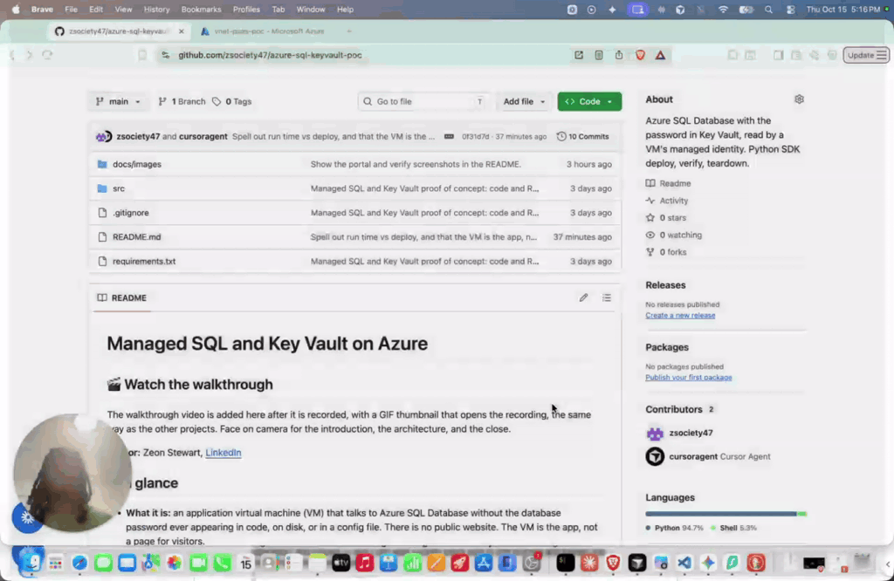

# Post 1: Video

[](https://www.loom.com/share/326b50f1396142d9848704c6918908b5)

Face on camera for the introduction, the architecture, and the close. Click the thumbnail to play.

**Publish:** Monday, October 26, 2026, 9:00 AM Eastern  
**Type:** native LinkedIn video (download the file from Loom; never paste a Loom URL)  
**Recording:** https://www.loom.com/share/326b50f1396142d9848704c6918908b5  
**Visual:** still frame of your face from the intro, Canva 1920×1080 PNG. Overlay: "Azure SQL. Password in Key Vault."

## This recording

Walkthrough of Managed SQL and Key Vault on Azure. Face on camera for the introduction, the architecture, and the close.

Download the file from [the Loom](https://www.loom.com/share/326b50f1396142d9848704c6918908b5) and upload that file. Do not paste the Loom URL on LinkedIn.

## Post

```text
The password is not in the repo. It is not on disk.

I walked through Managed SQL and Key Vault on Azure.

The VM asks for a token, reads SqlAdminPassword, and queries SQL.

When it tries to write a secret, Key Vault returns 403.

Would you keep the SQL password in the vault, or drop it with Entra ID?

https://github.com/zsociety47/azure-sql-keyvault-poc

#Azure #KeyVault #ManagedIdentity #CloudComputing #DevOps
```
